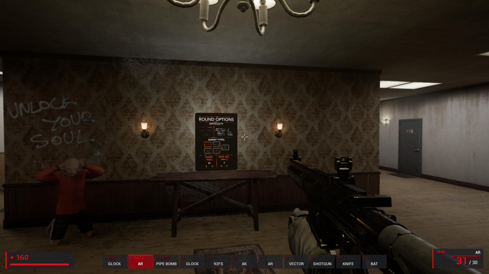
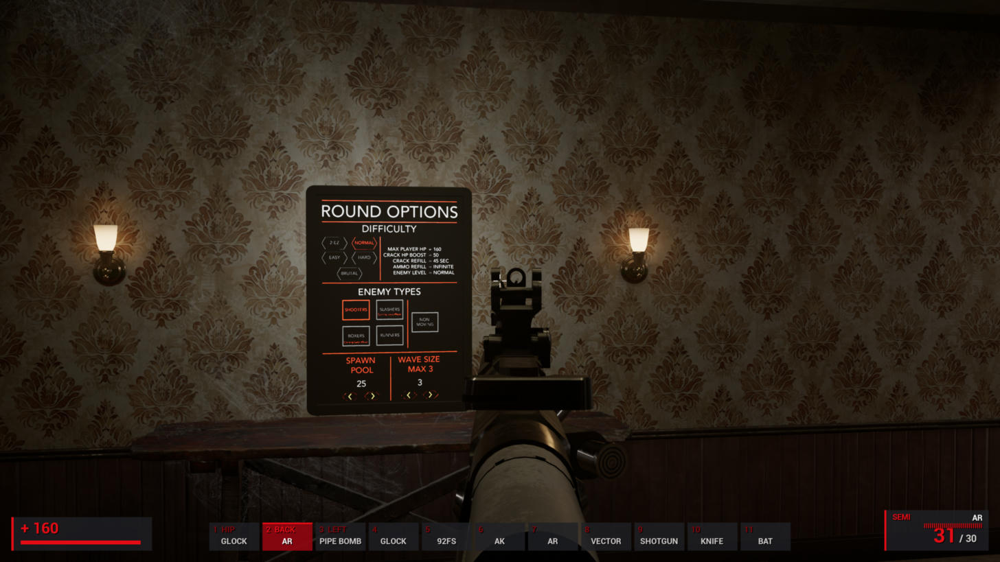
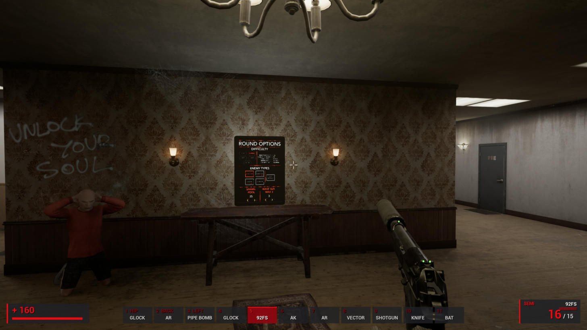
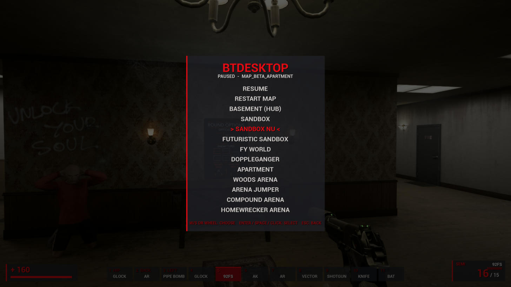
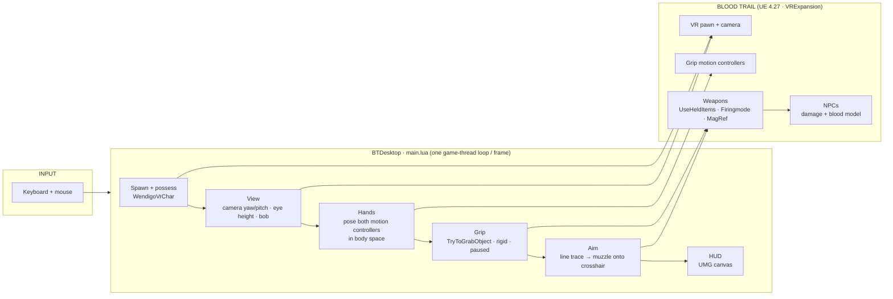

<p align="center">
  
</p>

<p align="center">
  <a href="https://github.com/doktordestrukt/BloodTrailDesktop/releases/latest"></a>
  
  
  
  
</p>

<p align="center">
  <b>Play the VR shooter <i>Blood Trail</i> on a flat screen with keyboard and mouse.</b><br>
  First-person viewmodel · two-handed weapons · aim down sights · a black-and-red 2D HUD · no game files changed.
</p>

<p align="center">
  <a href="https://github.com/doktordestrukt/BloodTrailDesktop/releases/latest"></a>
  <a href="#-architecture"></a>
  <a href="#-controls"></a>
</p>

---

## ▮ Screens

<table>
  <tr>
    <td></td>
    <td></td>
  </tr>
  <tr>
    <td align="center"><sub>HIP FIRE · loadout bar · ammo + fire mode · health</sub></td>
    <td align="center"><sub>AIM DOWN SIGHTS · sights exactly on the crosshair</sub></td>
  </tr>
  <tr>
    <td></td>
    <td></td>
  </tr>
  <tr>
    <td align="center"><sub>SIDEARMS · holster slots from the basement loadout board</sub></td>
    <td align="center"><sub>ESC MENU · 21 maps · basement hub · restart</sub></td>
  </tr>
</table>

## ▮ Features

| | |
|---|---|
| **◆ No headset** | Starts straight into the basement hub. SteamVR never needs to open (`-nohmd`). |
| **◆ Real viewmodel** | Weapons are held through the game's own grip system and locked rock-still to your view, the right glove on the grip and the left glove exactly where the game poses the support hand — handguard, shotgun pump, or cupped under a pistol. |
| **◆ Zero-deviation aim** | Rounds leave exactly along the muzzle, and the muzzle tracks the point under the crosshair — hip or sights. |
| **◆ Aim down sights** | Per-weapon sight alignment, zoom with the mouse wheel. |
| **◆ Full arsenal** | Holster loadout + Glock, 92FS, AK, AR, Vector, shotgun, knife, bat, pipe bombs. SEMI / BURST / AUTO, working reloads. |
| **◆ Melee that hits** | Swings trace from your eye and deal real damage through the game's damage path. |
| **◆ Game actions** | Crack heal, night vision, flashlight, grenades, click-to-press buttons and boards. |
| **◆ 2D HUD** | Black/red UMG HUD: loadout bar, ammo ticks, fire mode, health, white crosshair. |
| **◆ Settings menu** | Esc: graphics, rebindable controls, gameplay options and the wrist-watch info, all saved. |
| **◆ Radio** | Your own music from the game's `Music` folder: song list, play / pause, next / prev, speed, volume, shuffle, a seek bar you click to jump, and a NOW PLAYING panel. Enemies can hear it — the louder, the further. |
| **◆ Movement** | Sprint, crouch, jump, military view bob, low-ready when sprinting. |
| **◆ Sound fixed** | The game mutes itself without VR focus — the installer fixes that. |

## ▮ Install

> You need **Blood Trail on Steam** (Windows). Everything else is in the download.

1. Download **`BloodTrailDesktop-v1.3.0.zip`** from [Releases](https://github.com/doktordestrukt/BloodTrailDesktop/releases/latest) and unzip it anywhere.
2. Close the game, double-click **`Install.bat`**. It finds the game through your Steam libraries (or asks for the folder), installs UE4SS if you don't have it, and installs the mod.
3. Steam → right-click **Blood Trail** → **Properties** → **Launch Options**: `-nohmd`
4. Start the game from Steam and click into the window. You spawn in the basement.

| File | Does |
|---|---|
| `Install.bat` | install / update (your `BTDesktop.ini` is kept) |
| `Uninstall.bat` | remove the mod, the sound setting, and UE4SS if this installer added it |
| `FixSound.bat` | game silent? run while the game is running — unmutes it in the Windows Volume Mixer |

To play in VR again: run `Uninstall.bat` and remove `-nohmd`.

## ⌨ Controls

| Key | Action | Key | Action |
|---|---|---|---|
| `W A S D` | move | `Mouse` | look |
| `Shift` | sprint | `Ctrl` / `C` | crouch |
| `Space` | jump | `Esc` | menu / change map |
| `LMB` | fire · melee · throw · touch | `RMB` (hold) / `Z` | aim down sights |
| `Wheel` | switch weapon (zoom while aiming) | `1`–`9` `0` `-` | pick weapon slot (knife `0`, bat `-`) |
| `R` | reload (with animation) | `B` | fire mode |
| `E` | press / touch what you look at | `Q` | holster |
| `G` | grab / drop | `T` / `MMB` | throw pipe bomb |
| `H` | crack (heal) | `N` | night vision |
| `F` | flashlight | `V` | reset hands |
| `M` | radio on / off | `.` | next song |

<details>
<summary><b>Debug keys</b></summary>

`F1` debug text · `F2` god mode · `F3` spawn NPC · `F4` noclip · `F5` slow motion · `F6` release mouse · `F7` game's own keys · `F8` status to log · `J` diagnostics · `Alt`/`X` + mouse move a hand freely
</details>

**Every key can be rebound in game: `Esc` → CONTROLS.** `Esc` also has GRAPHICS (preset, shadows, textures, AA, resolution scale, vsync, frame limit, window mode, FOV), GAMEPLAY (aim zoom, view bob, speeds, crosshair, gloves) and WATCH (health, crack, kills, score — what the wrist watch shows in VR). All saved to `BTDesktop.ini`.

## ◆ Architecture

BloodTrail Desktop is one UE4SS Lua script running inside the game. It does not patch the exe or any game asset; it drives the game's **own VR pawn** as if a headset and two controllers were attached.



### How it works

| Layer | What happens |
|---|---|
| **Boot** | Without a headset the game never spawns a player. ~1.5 s after a level loads the mod asks the game mode to `RestartPlayer`, and if nothing appears it spawns `WendigoVrChar_C` at the PlayerStart and possesses it. Then it switches the HMD off and takes over camera and hands. The basement's early-access board is acknowledged for you. |
| **View** | Yaw turns the pawn, pitch tilts `VRReplicatedCamera`. Eye height, crouch, FOV/zoom and a military view bob (step dip, foot sway, roll) are applied to the camera's relative transform. |
| **Hands** | `Left/RightMotionController` are posed every frame in body space (the camera's parent), so they move in the same frame as you — no lag. The game's physics gloves, which chase the controllers and fly off without VR tracking, are pinned to the controllers with physics off and shown, so the real gloves are your hands. While a weapon is held, the left glove is placed on the support-hand pose the game's artists made for that weapon (`OffHandMeshL`, read from the weapon, never shown: showing it makes the game drop the weapon). The gloves are pinned to the controllers every frame, because the game switches their physics back on when it re-grips a weapon after a shot. |
| **Grip** | Each weapon is spawned once per slot and gripped through the pawn's own `TryToGrabObject`, so the game treats it as genuinely held. The grip is switched to VRExpansion's `AttachmentGrip` (a real scene attachment to the hand, not a physics handle) and paused; the weapon stays in the grip list. |
| **Viewmodel** | The game keeps the weapon on the controller with its own grip offset. The mod measures that offset from both world transforms every frame and poses the controller as *weapon × offset⁻¹*, so the gun lands exactly at its camera-space pose. The game attaches the weapon to the hand's grab sphere — a rigid child of the controller — so this offset is exact every frame: no lag, no drift after switching weapons, perfectly still while walking, strafing or turning. The pose is levelled so the gun's top always points up. |
| **Aim** | Every weapon is zeroed at 25 m: the muzzle (`FireDirection`) points at the crosshair at that range, hip or sights, without swinging around with whatever is under the crosshair. Measured from the game's pooled bullets: rounds leave along `FireDirection` with 0.00° deviation, so shots land on the crosshair at the hip and down the sights. |
| **Weapons** | Trigger = the pawn's `UseHeldItems`. Fire modes = the gun's `Firingmode` (0 auto · 1 semi · 2 burst). Reload fills the magazine, releases the bolt and chambers a round. |
| **Melee** | Swings trace from the eye; hits go to the NPC's `BludgeonDamage` / `StabbingDamage`, falling back to the same damage event the game's bullets use. |
| **HUD** | A game widget class is created only as a host; its widget tree is replaced with the mod's own canvas, images and text — screen space, never clipped or darkened. |
| **Safety** | One persistent `LoopInGameThreadAfterFrames` loop, every UObject access in `pcall`, all references forgotten on level change, no mesh `LoadAsset`. |
| **Sound** | The game ships `UnfocusedVolumeMultiplier=0.0` and never gets VR focus on a desktop, so it mutes itself. The installer sets `1.0` in your own `%LOCALAPPDATA%` Engine.ini (not a game file). |

### Repository

```
BloodTrailDesktop/
├─ Install.bat · Uninstall.bat · FixSound.bat   one-click launchers
├─ installer/
│  ├─ install.ps1          finds the game, installs UE4SS + mod, sound fix
│  └─ fix_sound.ps1        Core Audio: unmute the game's sessions
├─ mod/BTDesktop/
│  ├─ Scripts/main.lua     the whole mod
│  ├─ BTDesktop.ini        settings
│  └─ README.md            in-game folder reference (full key list)
├─ third_party/ue4ss/      UE4SS 3.0.1 (MIT, SHA-256 verified)
└─ docs/                   banner + screenshots
```

## ▮ Troubleshooting

| Problem | Fix |
|---|---|
| SteamVR opens / black screen | Add `-nohmd` to the Steam launch options. Arguments passed any other way are dropped by Steam. |
| No sound | Run `FixSound.bat` while the game runs. Check the Windows Volume Mixer. |
| Mouse doesn't look around | Click into the game window once (or `F6`). |
| Nothing happens at all | Check `BTVR\Binaries\Win64\ue4ss\UE4SS.log` for `[BTDesktop]` lines. |
| Using the VR co-op mod too | Disable one of them — both drive the same pawn. |

---

<p align="center">
  <sub>Unofficial fan project · not affiliated with Electrovore, LLC or the UE4SS team · you need your own copy of Blood Trail.<br>
  © 2026 doktordestrukt · source-available, see <a href="LICENSE">LICENSE</a> · third-party: <a href="THIRD_PARTY_NOTICES.md">notices</a></sub>
</p>
